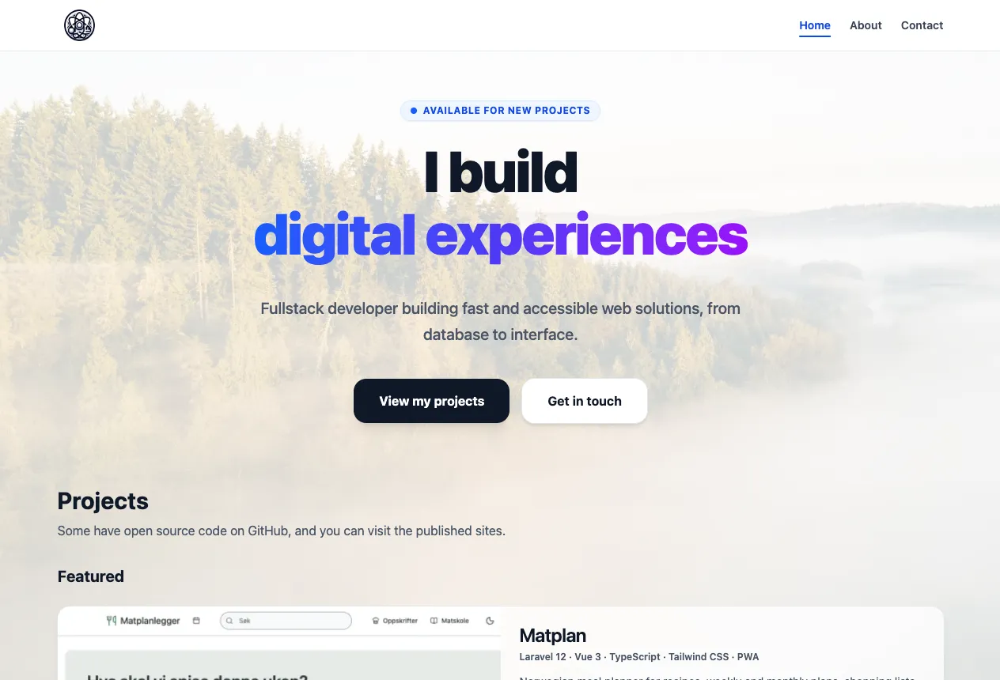

# Portfolio

A portfolio of fullstack web development projects.

<a href="http://portfolio.wexox.no"></a>

**Live site:** [portfolio.wexox.no](http://portfolio.wexox.no)

[](https://forge.laravel.com/lasse-jle/gorgeous-morning-gtd/3504229)

## Description

The site presents a hand-picked list of projects in three groups:

- **Featured:** current fullstack work, such as Matplan (Laravel and Vue), Drinktree and Project Management (Kotlin and Spring Boot) and E-Learning (.NET and Blazor).
- **More projects:** earlier work and school projects, including Holidaze, an online shop, an auction house and several WordPress and static sites.
- **Archive:** projects that have been taken offline.

There is also an About page and a Contact page. The contact form has no backend: it opens the visitor's own e-mail program with the message filled in.

## Built With

- [React](https://react.dev/) with [React Router](https://reactrouter.com/)
- [Vite](https://vite.dev/)
- [Tailwind CSS](https://tailwindcss.com/)

## Getting Started

### Installing

1. Clone the repository:

```bash
git clone git@github.com:wexnox/Portfolio.git
```

2. Install dependencies:

```bash
npm install
```

### Running

Start the development server:

```bash
npm run dev
```

Build for production and preview the result:

```bash
npm run build
npm run preview
```

### Adding a project

Projects live in `src/projects/Projects.jsx`. The order in the list is the order on the page. Set `featured: true` to show a project at the top, or `isArchived: true` to move it to the archive.

### Adding a page

Add the route in `src/App.jsx` and its path to `ROUTES` in `vite.config.js`. The build copies `index.html` into a folder for each route, so direct links work without a server rewrite rule.

## Deployment

The site is deployed with Laravel Forge from the `main` branch.

## Contributing

Contributions are welcome! Please open an issue or submit a pull request.

## Contact

Use the [contact page](http://portfolio.wexox.no/contact/) or find me on [GitHub](https://github.com/wexnox).

## Acknowledgments

Special thanks to [Noroff](https://www.noroff.no/) for providing the opportunity to showcase my skills.
